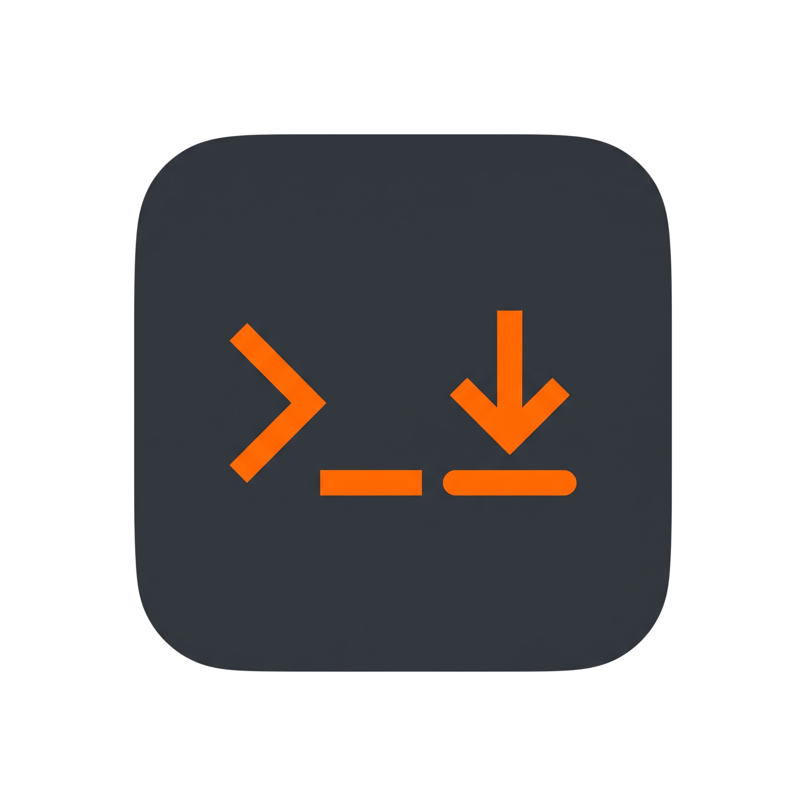
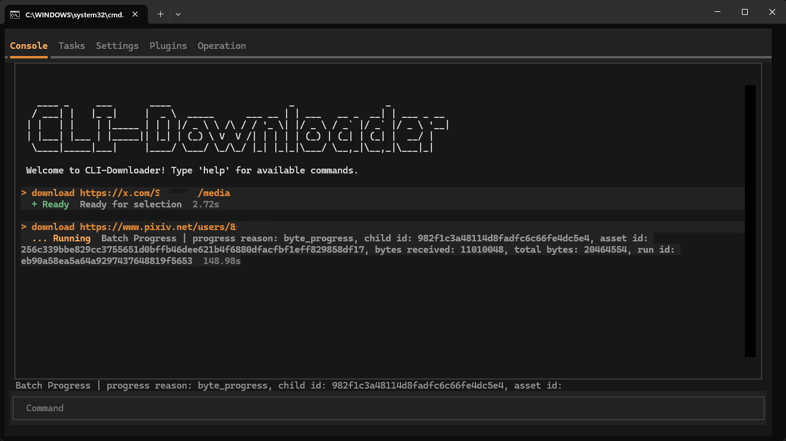
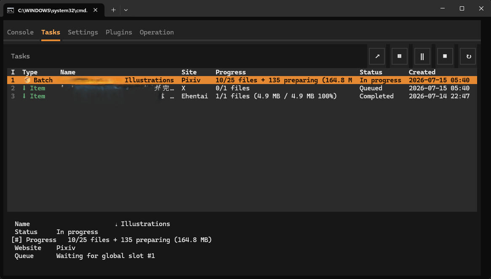
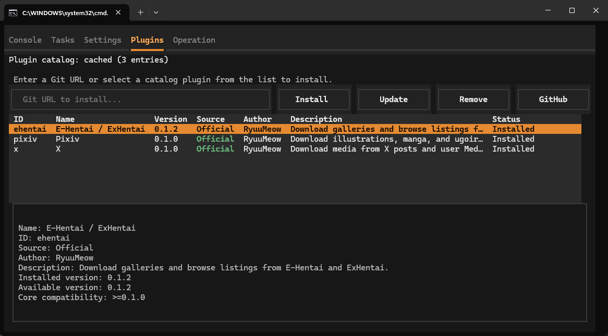
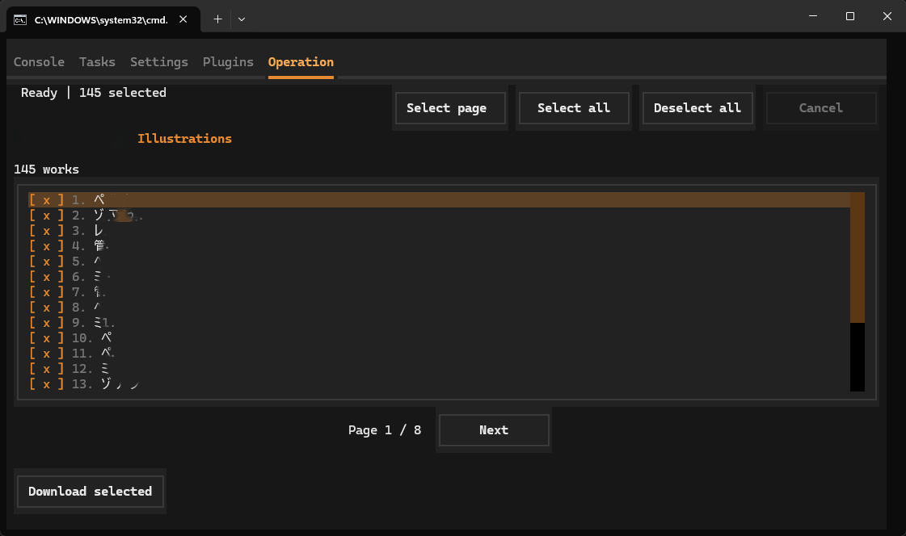
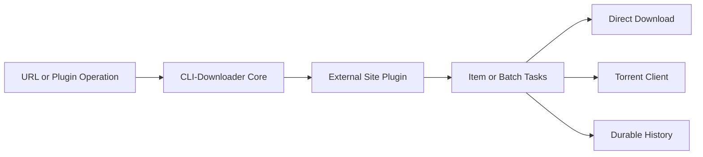

<p align="right">
  <strong>English</strong> |
  <a href="README.zh-TW.md">繁體中文</a> |
  <a href="README.zh-CN.md">简体中文</a>
</p>

<p align="center">
  
</p>

<h1 align="center">CLI-Downloader</h1>

<p align="center">
  A plugin-driven download manager with persistent tasks, batch control,<br>
  torrent integration, and an interactive terminal UI.
</p>

<p align="center">
  <a href="https://github.com/RyuuMeow/CLI-Downloader/actions/workflows/verify.yml"></a>
  <a href="https://github.com/RyuuMeow/CLI-Downloader/releases"></a>
  
  
  
</p>

<p align="center">
  
</p>


CLI-Downloader provides one consistent task, history, configuration, and user-interface layer while website support remains in independently maintained external plugins. It is designed for interactive terminal use, repeatable batch downloads, and automation through machine-readable output.

## Features

- **One app, many websites.** Add support for the sites you need through installable plugins instead of switching between unrelated downloaders.
- **Continue where you left off.** Tasks and Batch progress are saved, so closing the application does not erase your download state.
- **Stay in control of large downloads.** Pause, resume, cancel, retry, or completely rebuild an Item or Batch task when needed.
- **Choose how files arrive.** Use direct downloads, a configured torrent client, or let a plugin select the best available method automatically.
- **Keep tasks and history separate.** Remove finished tasks without losing their durable download records.
- **Discover plugins in the app.** Browse Official and Community catalogs, review plugin details, and see when updates are available.
- **Use a UI or a command line.** Work in the keyboard-driven terminal interface or use JSON output in scripts and automation.
- **Ready for different setups.** Choose an Installer or Portable build and use the interface in English, Traditional Chinese, or Simplified Chinese.

## Quick Start

### Windows Installer

Download the latest `CLI-Downloader-<version>-windows-x64-setup.exe` from [GitHub Releases](https://github.com/RyuuMeow/CLI-Downloader/releases/latest). The per-user Installer can add CLI-Downloader to your user `PATH` and does not require administrator privileges.

### Windows Portable

Download and extract the latest `CLI-Downloader-<version>-windows-x64-portable.zip`. Run `CLI-Downloader.exe` to open the interactive shell, or use `clid.cmd` to forward command-line arguments without modifying `PATH`.

### Run from Source

Python 3.11 or newer is required.

```powershell
git clone https://github.com/RyuuMeow/CLI-Downloader.git
cd CLI-Downloader
python -m pip install -e .
clid
```

## Basic Usage

Open the interactive shell:

```powershell
clid
```

Route a URL through an installed plugin, inspect the plan first, and query persisted state:

```powershell
clid download <url> --dry-run
clid download <url>
clid download <list-url>
clid download <list-url> --select <item-id>
clid tasks
clid history
clid plugins list
clid doctor
```

Use `clid <command> --help` for command-specific options. Commands that support `--json` can be consumed by scripts and other tools.

A command-line list or Batch URL without `--select` downloads every item returned by that
operation. Repeat `--select <item-id>` to restrict the Batch to a subset. The interactive Shell
continues to show the plugin-provided selection page.

For Agent-assisted work, keep downloads in the visible Shell owner:

```powershell
clid shell status --json
clid shell ensure --visible --wait-ready --json
clid download <url> --dry-run --json
clid download <url> --detach --json
clid tasks show <task-id>
clid tasks pause <task-id>
clid tasks resume <task-id>
```

`--detach` reports durable acceptance and the Task ID; it does not claim final success. If the
owner disconnects, inspect that existing Task and History before retrying, rather than creating a
replacement Task. See the [Agent Skill guide](skills/cli-downloader/README.md) for the full
authorization and ownership workflow.

When the visible Shell closes with unfinished work, it warns, stops accepting new commands,
and leaves recoverable checkpoints for the next Shell startup.

## Visual Tour

### Tasks and Batches

Inspect Item and Batch hierarchies, progress, queue state, and available lifecycle actions without losing persisted work after restarting the application.

<p align="center">
  
</p>

### Plugin Marketplace

Browse installed, Official, and Community plugins; inspect package metadata; and identify updates or restart requirements from one screen.

<p align="center">
  
</p>

### Plugin Operations

Plugins can expose list and search operations with keyboard selection and pagination while Core remains responsible for creating and controlling download tasks.

<p align="center">
  
</p>

## Plugin System

CLI-Downloader Core does not bundle website-specific downloaders. Installed plugins classify URLs, resolve website data, and declare supported operations; Core owns task creation, scheduling, retries, storage, downloads, and history.



The remote catalog is maintained in the [CLI-Downloader Plugin Marketplace](https://github.com/RyuuMeow/CLI-Downloader-Plugin-Marketplace). Activated plugins are trusted local Python code and are not sandboxed, so install plugins only from sources you trust.

See [Plugins/README.md](Plugins/README.md) for package layout, activation behavior, and plugin development guidance.

To start a plugin from a ready-made structure, use the [CLI-Downloader Plugin Template](https://github.com/RyuuMeow/CLI-Downloader-Plugin-Template). Finished plugins can be submitted to the [CLI-Downloader Plugin Marketplace](https://github.com/RyuuMeow/CLI-Downloader-Plugin-Marketplace) for catalog consideration.

## Agent Skill

This repository includes a ready-to-use [CLI-Downloader Agent Skill](skills/cli-downloader/) for compatible AI agent environments. It gives an agent project-specific guidance to:

- inspect current tasks and durable history without reading the database directly;
- validate URL routing with a dry run before starting a download;
- add and verify download tasks with explicit user authorization;
- diagnose unsupported URLs and plugin routing problems; and
- research, scaffold, test, and document external website plugins; and
- submit authorized work to the visible Shell owner and control the resulting Task through JSON commands.

The Agent Skill does not grant additional permissions, bypass confirmation requirements, or make third-party plugins trustworthy. Agents must still follow the user's authorization and the security boundaries of their host environment.

### Install the Skill

Clone this repository, then copy the **entire** `skills/cli-downloader` directory so its references and plugin template remain available.

**Codex** — install for your user account:

```powershell
New-Item -ItemType Directory -Force "$HOME\.agents\skills" | Out-Null
Copy-Item -Recurse -Force ".\skills\cli-downloader" "$HOME\.agents\skills\"
```

Invoke it explicitly with `$cli-downloader`, or let Codex select it when the request matches. For a project-only installation, copy it to `<project>/.agents/skills/cli-downloader` instead.

**Claude Code** — install for your user account:

```powershell
New-Item -ItemType Directory -Force "$HOME\.claude\skills" | Out-Null
Copy-Item -Recurse -Force ".\skills\cli-downloader" "$HOME\.claude\skills\"
```

Invoke it explicitly with `/cli-downloader`, or let Claude select it when relevant. For a project-only installation, copy it to `<project>/.claude/skills/cli-downloader` instead.

See the [Agent Skill installation guide](skills/cli-downloader/README.md) for scope, verification, updates, and generic Agent Skills-compatible environments.

**Let an Agent install it for you** — you can ask a compatible Agent to install the Skill from this checkout, for example: `Install the CLI-Downloader Agent Skill from this repository and verify that it is available.` Review the proposed file operations and approve them according to your environment's permission rules.

## Download Strategies

Plugins may support one or more strategies:

- `auto` lets the plugin choose the best available method.
- `direct` downloads resolved files through Core.
- `torrent` submits a torrent to the configured torrent client.

```powershell
clid download <url> --strategy auto
clid download <url> --strategy direct
clid download <url> --strategy torrent
```

Actual strategy support depends on the selected plugin and URL.

## Tasks, History, and User Data

Tasks represent current controllable work. History is a separate durable record, so deleting a task does not delete its history unless an explicit history action is requested. Settings, plugins, logs, downloads, tasks, and history remain in per-user data locations across upgrades and uninstallations.

## Disclaimer

CLI-Downloader is an open-source **download framework**. Core does not bundle support or parsing logic for any specific website. Website-specific behavior is provided by independently maintained plugins installed by the user.

### Project Scope

- Core provides general capabilities such as plugin contracts, task scheduling, rate limiting, persistence, and download pipelines.
- CLI-Downloader does not endorse any plugin or guarantee that a plugin is safe, lawful, accurate, or compatible with a website's terms.
- Network activity may be initiated by installed plugins or performed by Core on their resolved download requests, plugin catalog access, and configured external integrations.

### Limitation of Liability

- This project is provided **“AS IS”** under the [MIT License](LICENSE), without express or implied warranties.
- You assume all risks arising from CLI-Downloader and any installed plugin, including account restrictions, service bans, legal claims, data loss, or unexpected network and filesystem activity.
- You are responsible for complying with applicable laws, copyright rules, website terms of service, and for obtaining any required authorization or usage rights.
- Do not use this project for unauthorized access, copyright infringement, unlawful distribution, or abusive bulk requests. The MIT License permits commercial use of this software but does not grant rights to third-party websites or downloaded content.

### Plugins

Plugins may contain additional website-specific behavior and terms. Read each plugin's README before installation or use. Community plugins are maintained independently; their behavior and risks do not represent the position of the CLI-Downloader Core project.

By installing, compiling, or using CLI-Downloader or a plugin, you acknowledge this disclaimer and any additional terms documented by that plugin.

## Documentation

- [Project scope and behavior](docs/CLI-Downloader.md)
- [Documentation index](docs/Index.md)
- [System architecture](docs/structure/SystemDesign.md)
- [Repository structure](docs/structure/SystemStructure.md)
- [Changelog](CHANGELOG.md)

## Development

Install the development and packaging dependencies, then run the complete verification gate:

```powershell
python -m pip install -e ".[dev,package]"
.\Scripts\Verify.ps1
```

Build the Windows Portable package with:

```powershell
.\Scripts\BuildPortable.ps1
```

Bug reports, feature proposals, documentation improvements, and plugin-contract discussions are welcome through [GitHub Issues](https://github.com/RyuuMeow/CLI-Downloader/issues).

## License

CLI-Downloader is released under the [MIT License](LICENSE).
