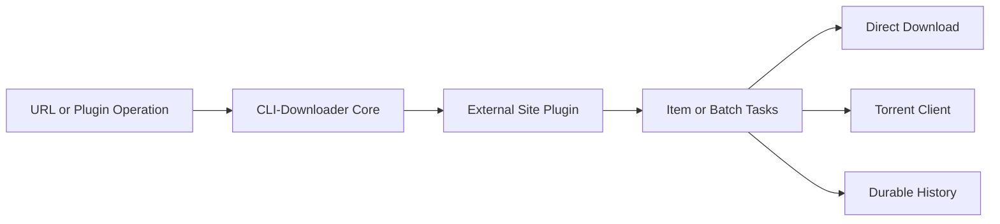

<p align="right">
  <strong>English</strong> |
  <a href="README.zh-TW.md">繁體中文</a> |
  <a href="README.zh-CN.md">简体中文</a>
</p>

<p align="center">
  
</p>

<h1 align="center">CLI-Downloader — Interactive Plugin-Based Collection Manager</h1>

<p align="center">
  An interactive, plugin-driven download framework for browsing, collecting, and organizing media from authenticated websites.<br>
  Optimized for image collections and gallery-based workflows.
</p>

<p align="center">
  <a href="https://github.com/RyuuMeow/CLI-Downloader/actions/workflows/verify.yml"></a>
  <a href="https://github.com/RyuuMeow/CLI-Downloader/releases"></a>
  
  
  
</p>

<p align="center">
  
</p>

**Status:** Early release. Core workflows are usable, but the Plugin API may change before v1.0.

## Why CLI-Downloader?

Browse an artist’s works, select multiple galleries, sign in when required, and automatically organize the results. 

Instead of dealing with ad-hoc scripts or managing separate tools for different sites, CLI-Downloader provides a single cohesive interface. 

### The Workflow

```text
Install Plugin → Login → Search → Select → Download → Resume Later
```

## How It Differs

While **yt-dlp** focuses on video extraction and **gallery-dl** excels at headless gallery scraping on supported sites, **CLI-Downloader** focuses on persistent and interactive collection workflows. We treat the downloader as an interactive hub where plugins act as mini-applications.

## Visual Tour

### Tasks and Batches

Inspect Item and Batch hierarchies, progress, queue state, and available lifecycle actions without losing persisted work after restarting the application.

<p align="center">
  
</p>

### Plugin Marketplace

Browse installed, Official, and Community plugins; inspect package metadata; and identify updates or restart requirements from one screen.

<p align="center">
  
</p>

### Plugin Operations

Plugins can expose list and search operations with keyboard selection and pagination while Core remains responsible for creating and controlling download tasks.

<p align="center">
  
</p>

## Plugin Architecture

CLI-Downloader Core does not bundle website-specific downloaders. Installed plugins classify URLs, resolve website data, and declare supported operations; Core owns task creation, scheduling, retries, storage, downloads, and history.



## Key Features

- **Interactive Plugin Pages:** Plugins can provide search pages, paginated lists, forms, actions, and multi-selection workflows directly in the terminal interface.
- **Browser Login Sessions:** Sign in through an isolated browser session without manually extracting or copying cookies.
- **Folder Templates:** Automatically organize downloaded files into customized structures. For example:
  ```text
  {author_name}/{artwork_id}-{title}
  ```
  Output:
  ```text
  Artist Name/12345-Illustration Title/
  ```
- **Persistent Tasks:** Download progress, queues, and task states are saved. Close the app at any time and resume exactly where you left off.
- **Multiple Download Strategies:** Select between direct file downloads or hand off jobs to an integrated Torrent client.
- **Automation Ready:** Prefer scripts over the TUI? Every command supports `--json` output for headless automation.

## Supported Websites

CLI-Downloader Core itself does not contain website scrapers. **Website support is installed separately through the Plugin Marketplace.** 

Currently available repository official plugins:
- **[Pixiv](https://github.com/RyuuMeow/Pixiv-Plugin.git)** (Images, Illustrations)
- **[EHentai](https://github.com/RyuuMeow/EHentai-Plugin.git)** (Gallery, Torrent)
- **[X / Twitter](https://github.com/RyuuMeow/X-Plugin.git)** (Images, Videos)
- **[Douyin](https://github.com/RyuuMeow/Douyin-Plugin.git)** (Images, Videos)

Browse and install plugins directly inside the application using the Plugin Marketplace tab, or via the command line: `clid plugins install pixiv`.

## Quick Start

### Windows Installer

Download the latest `windows-x64-setup.exe` from [GitHub Releases](https://github.com/RyuuMeow/CLI-Downloader/releases/latest). It adds CLI-Downloader to your `PATH` and doesn't require administrator privileges.

### Portable Build

Download `windows-x64-portable.zip`. Run `CLI-Downloader.exe` to open the interactive shell, or use `clid.cmd` for command-line arguments.

### Basic Usage

Open the interactive shell:
```powershell
clid
```

Or use the command line directly:
```powershell
clid plugins list
clid download <url> --dry-run
clid download <url>
```

## Agent Skill

This project includes a ready-to-use Agent Skill (`skills/cli-downloader`). Use it to supercharge your AI assistants (like Claude Code or Codex). 

**Ask an Agent to:** research a website, scaffold a plugin, implement routing, add tests, and generate documentation.

See the [Agent Skill documentation](skills/cli-downloader/README.md) for installation instructions.

## FAQ

**Is this a replacement for yt-dlp?**
No. If your primary goal is video extraction from YouTube and video platforms, yt-dlp is superior. CLI-Downloader is designed for gallery aggregation, image collections, and authenticated browsing workflows.

**Are plugins sandboxed?**
No. Activated plugins are trusted local Python code. You should only install plugins from trusted sources.

**Can it use browser login sessions?**
Yes. You can invoke a browser-based login flow that securely persists your session state, eliminating the need to copy-paste cookies.

## Disclaimer & Security

CLI-Downloader is an open-source download framework provided "AS IS". We do not endorse or guarantee the lawfulness of third-party plugins. 

- For security practices and vulnerability reporting, see [SECURITY.md](SECURITY.md).
- For complete terms, limitations of liability, and plugin warnings, read [DISCLAIMER.md](DISCLAIMER.md).

## Documentation

- [Project scope and behavior](docs/CLI-Downloader.md)
- [System architecture](docs/structure/SystemDesign.md)
- [Repository structure](docs/structure/SystemStructure.md)
- [Changelog](CHANGELOG.md)

## License
Released under the [MIT License](LICENSE).
