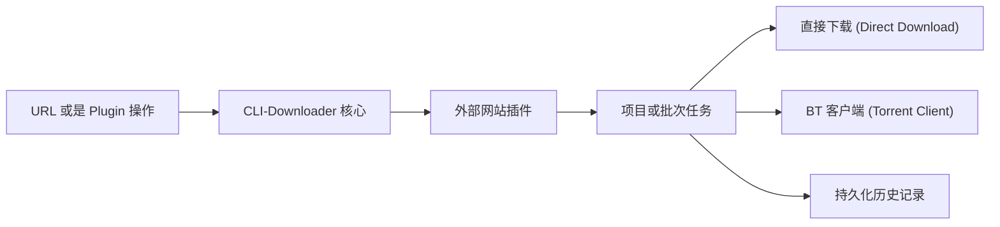

<p align="right">
  <a href="README.md">English</a> |
  <a href="README.zh-TW.md">繁體中文</a> |
  <strong>简体中文</strong>
</p>

<p align="center">
  
</p>

<h1 align="center">CLI-Downloader — 交互式插件下载管理器</h1>

<p align="center">
  这是一个以插件 (Plugin) 为核心驱动的交互式下载框架，专为浏览、收集以及整理来自需要登录认证网站的媒体资源而设计。<br>
  特别针对图片收集和图库型工作流程进行了优化。
</p>

<p align="center">
  <a href="https://github.com/RyuuMeow/CLI-Downloader/actions/workflows/verify.yml"></a>
  <a href="https://github.com/RyuuMeow/CLI-Downloader/releases"></a>
  
  
  
</p>

<p align="center">
  
</p>

**状态：** 早期预览版。核心工作流程已可用，但插件 (Plugin) API 在 v1.0 发布前仍可能发生变动。

## 为什么选择 CLI-Downloader？

你可以直接在终端中浏览画师的作品、选择多个图库、在需要时进行登录，并将下载结果自动整理得井然有序。

CLI-Downloader 提供了一个统一的界面，让你不再需要到处寻找零碎的脚本，或为每个网站安装独立的下载工具。

### 完整操作流程

```text
安装插件 → 登录账号 → 搜索资源 → 选取目标 → 开始下载 → 随时暂停与恢复
```

## 它有什么不同？

虽然 **yt-dlp** 是视频提取领域的王者，而 **gallery-dl** 擅长无头 (headless) 图库爬虫，但 **CLI-Downloader** 更加专注于提供“持久化”和“交互式”的收集流程。我们将这个下载器视为一个交互中心，而所有的插件都是在其内部运行的微型应用程序。

## 视觉导览

### 任务与批次管理

在这里你可以检查单一项目与批次任务的层级、进度、队列状态以及生命周期操作。所有进度都会被持久化保存，重新启动应用程序也不会丢失下载记录。

<p align="center">
  
</p>

### 插件市场 (Plugin Marketplace)

从这里你可以浏览已安装的、官方的以及社区提供的插件；查看包信息；并在同一个画面中识别更新或是否需要重新启动。

<p align="center">
  
</p>

### 插件操作 (Plugin Operations)

插件可以提供包含键盘选取和分页功能的列表与搜索操作，而 CLI-Downloader 核心则持续负责创建与控制下载任务。

<p align="center">
  
</p>

## 核心与插件架构

CLI-Downloader 核心 (Core) 不包含任何特定网站的下载逻辑。由用户安装的插件 (Plugin) 负责对 URL 进行分类、解析网站数据，以及声明支持的操作；核心则接管任务创建、调度、重试、存储、下载和历史记录管理。



## 核心功能

- **交互式插件页面：** 插件可以直接在终端界面中提供搜索页面、分页列表、表单、操作行为以及多选工作流程。
- **浏览器登录会话：** 通过独立的浏览器画面完成登录，无需手动复制或提取 Cookies。
- **文件夹模板：** 自动将下载的文件整理进客制化的文件夹结构中。例如：
  ```text
  {author_name}/{artwork_id}-{title}
  ```
  输出：
  ```text
  画师名称/12345-插图标题/
  ```
- **持久化任务：** 下载进度、队列与任务状态都会被保存下来。随时关闭程序，下次开启时会从中断的地方准确恢复。
- **多种下载策略：** 可以选择直接下载文件，或将任务移交给集成的 Torrent 客户端处理。
- **自动化准备就绪：** 比较喜欢用脚本而非交互界面 (TUI)？每个命令都支持 `--json` 输出格式，让你轻松实现自动化。

## 支持的网站

CLI-Downloader 核心本身不包含网站爬虫。**网站的支持功能需要通过插件市场 (Plugin Marketplace) 额外安装。**

目前库内提供的官方插件：
- **[Pixiv](https://github.com/RyuuMeow/Pixiv-Plugin.git)** (图片、插画)
- **[EHentai](https://github.com/RyuuMeow/EHentai-Plugin.git)** (图库、BT)
- **[X / Twitter](https://github.com/RyuuMeow/X-Plugin.git)** (图片、视频)
- **[Douyin](https://github.com/RyuuMeow/Douyin-Plugin.git)** (图片、视频)

你可以直接在应用程序的“Plugin Marketplace”选项卡中浏览并安装，或者使用命令：`clid plugins install pixiv`。

## 快速上手

### Windows 安装程序

从 [GitHub Releases](https://github.com/RyuuMeow/CLI-Downloader/releases/latest) 下载最新的 `windows-x64-setup.exe`。它会将 CLI-Downloader 加入你的用户 `PATH` 变量中，且不需要管理员权限。

### 便携版 (Portable)

下载 `windows-x64-portable.zip`。解压后运行 `CLI-Downloader.exe` 即可开启交互式 Shell，或使用 `clid.cmd` 来传递命令行参数。

### 基本使用

开启交互式 Shell：
```powershell
clid
```

或直接在命令行使用：
```powershell
clid plugins list
clid download <url> --dry-run
clid download <url>
```

命令行中的列表或 Batch 网址如果未指定 `--select`，会下载该 operation 返回的全部项目；可重复
使用 `--select <item-id>` 将 Batch 限制为指定子集。交互式 Shell 仍会显示插件提供的选择页面。

如果由 Agent 协助操作，请让下载留在用户可见的 Shell owner 中：

```powershell
clid shell status --json
clid shell ensure --visible --wait-ready --json
clid download <url> --dry-run --json
clid download <url> --detach --json
clid tasks show <task-id>
clid tasks pause <task-id>
clid tasks resume <task-id>
```

`--detach` 只表示任务已经持久化接受，并不代表下载最终成功。如果 owner 中断，请先查询
原有 Task 和 History，再决定是否使用相同 request 重试，不要创建替代 Task。完整的授权与
owner 流程请参考 [Agent Skill 指南](skills/cli-downloader/README.md)。

如果可见的 Shell 在仍有未完成工作时关闭，会先显示警告、停止接受新命令，并留下可由下次
Shell 启动时恢复的检查点。

## AI 代理技能 (Agent Skill)

此项目包含一个开箱即用的 Agent Skill（位于 `skills/cli-downloader`）。用它来强化你的 AI 助手（例如 Claude Code 或 Codex）。

**你可以要求 Agent 帮你：** 研究目标网站、搭建 Plugin 骨架、实现路由、添加测试，以及生成说明文档。

请参阅 [Agent Skill 说明文档](skills/cli-downloader/README.md) 了解安装方式。

## 常见问题 (FAQ)

**这可以取代 yt-dlp 吗？**
不行。如果你主要目的是从 YouTube 或是各大视频平台下载视频，yt-dlp 是更好的选择。CLI-Downloader 的设计初衷是为了图库聚合、图片收藏以及需要登录认证的浏览工作流程。

**插件有沙盒 (Sandbox) 保护吗？**
没有。已启用的插件会作为受信任的本地 Python 代码运行。请务必只从你信任的来源安装插件。

**它可以支持需要浏览器登录的网站吗？**
可以。你可以调用基于浏览器的登录流程，它会安全地持久化保存你的会话状态，免去了复制粘贴 Cookies 的麻烦。

## 免责声明与安全性

CLI-Downloader 是一个开源的下载框架，以“现状 (AS IS)”提供。我们不背书也不保证任何第三方插件的合法性。

- 有关安全实践与漏洞报告，请参阅 [SECURITY.md](SECURITY.md)。
- 有关完整的条款、责任限制以及插件警告，请阅读 [DISCLAIMER.md](DISCLAIMER.md)。

## 说明文档

- [CLI 命令手册 (CLI Command Reference)](docs/CLI-Commands.md)
- [项目范围与行为](docs/CLI-Downloader.md)
- [系统架构](docs/structure/SystemDesign.md)
- [存储库结构](docs/structure/SystemStructure.md)
- [更新日志](CHANGELOG.md)


## 授权条款
采用 [MIT License](LICENSE) 发布。
