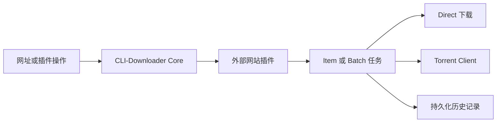

<p align="right">
  <a href="README.md">English</a> |
  <a href="README.zh-TW.md">繁體中文</a> |
  <strong>简体中文</strong>
</p>

<p align="center">
  
</p>

<h1 align="center">CLI-Downloader</h1>

<p align="center">
  具备持久化任务、批量控制、Torrent 集成<br>
  和交互式终端界面的插件驱动下载管理器。
</p>

<p align="center">
  <a href="https://github.com/RyuuMeow/CLI-Downloader/actions/workflows/verify.yml"></a>
  <a href="https://github.com/RyuuMeow/CLI-Downloader/releases"></a>
  
  
  
</p>

<p align="center">
  
</p>

CLI-Downloader 提供一致的任务、历史记录、设置和用户界面层，网站支持则由可独立维护的外部插件提供。它适用于交互式终端操作、可重复执行的批量下载，以及通过机器可读输出进行自动化。

## 功能特性

- **一套程序支持多个网站。** 通过可安装的插件加入需要的网站，不必在多套下载器之间切换。
- **关闭程序也能继续下载。** 任务和 Batch 进度会持久保存，重新打开后不会丢失下载状态。
- **大型下载仍然容易控制。** 随时暂停、继续、取消、重试，必要时也能完整重建 Item 或 Batch 任务。
- **自由选择下载方式。** 使用 Direct 下载、配置好的 Torrent Client，或由插件自动选择最合适的方法。
- **任务与历史记录互不绑定。** 清除已完成任务时，可以保留独立且持久的下载记录。
- **直接在程序内查找插件。** 浏览 Official 和 Community 列表、查看详细信息及可用更新。
- **界面操作和自动化都支持。** 使用键盘操作的终端界面，也能通过 JSON 输出接入脚本与其他工具。
- **适合不同使用方式。** 可选择 Installer 或 Portable，界面支持英文、繁体中文和简体中文。

## 快速开始

### Windows Installer

从 [GitHub Releases](https://github.com/RyuuMeow/CLI-Downloader/releases/latest) 下载最新的 `windows-x64-setup.exe`。Installer 采用当前用户安装，可将 CLI-Downloader 添加至用户 `PATH`，且不需要管理员权限。

### Windows Portable

下载并解压最新的 `windows-x64-portable.zip`。运行 `CLI-Downloader.exe` 可直接打开交互式 Shell；使用 `clid.cmd` 则可转发命令行参数，且不会修改 `PATH`。

### 从源代码运行

需要 Python 3.11 或更新版本。

```powershell
git clone https://github.com/RyuuMeow/CLI-Downloader.git
cd CLI-Downloader
python -m pip install -e .
clid
```

## 基本用法

打开交互式 Shell：

```powershell
clid
```

通过已安装的插件处理网址、先查看下载计划，以及查询持久化状态：

```powershell
clid download <url> --dry-run
clid download <url>
clid tasks
clid history
clid plugins list
clid doctor
```

使用 `clid <command> --help` 查看各命令选项。支持 `--json` 的命令可供脚本及其他工具读取。

## 界面导览

### Tasks 和 Batches

查看 Item 和 Batch 层级、进度、队列状态及可用的生命周期操作；重新启动程序后，持久化工作仍会保留。

<p align="center">
  
</p>

### 插件 Marketplace

浏览 Installed、Official 和 Community 插件，查看包信息，并在同一页面识别可用更新或需要重新启动的状态。

<p align="center">
  
</p>

### 插件 Operations

插件可以提供具备键盘选择和分页功能的列表与搜索操作；Core 则负责创建和控制实际下载任务。

<p align="center">
  
</p>

## 插件系统

CLI-Downloader Core 不内置任何网站专用下载器。已安装的插件负责分类网址、解析网站数据并声明支持的操作；Core 负责任务创建、调度、重试、存储、下载和历史记录。



远程列表由 [CLI-Downloader Plugin Marketplace](https://github.com/RyuuMeow/CLI-Downloader-Plugin-Marketplace) 维护。启用的插件属于受信任的本地 Python 代码，并不在沙箱中运行，因此请只安装来自可信来源的插件。

包结构、启用行为和插件开发方式请参考 [Plugins/README.md](Plugins/README.md)。

想从现成结构开始开发插件，可以使用 [CLI-Downloader Plugin Template](https://github.com/RyuuMeow/CLI-Downloader-Plugin-Template)。完成后可按照 [CLI-Downloader Plugin Marketplace](https://github.com/RyuuMeow/CLI-Downloader-Plugin-Marketplace) 的投稿方式提交，供列表收录评估。

## Agent Skill

本项目提供可供兼容 AI Agent 环境使用的 [CLI-Downloader Agent Skill](skills/cli-downloader/)，让 Agent 能按照项目规范：

- 通过公开命令查看当前任务和持久化历史，而不直接读取数据库；
- 在开始下载前使用 dry run 验证网址路由；
- 获得用户明确授权后创建并确认下载任务；
- 诊断不支持的网址和插件路由问题；以及
- 研究、创建、测试并编写外部网站插件文档。

Agent Skill 不会获得额外权限、不会绕过确认要求，也不代表第三方插件可信。Agent 仍须遵守用户授权及其运行环境的安全边界。

### 安装 Skill

克隆本项目后，请复制**完整的** `skills/cli-downloader` 目录，才能一并保留参考文档和插件模板。

**Codex** — 安装至当前用户：

```powershell
New-Item -ItemType Directory -Force "$HOME\.agents\skills" | Out-Null
Copy-Item -Recurse -Force ".\skills\cli-downloader" "$HOME\.agents\skills\"
```

使用 `$cli-downloader` 可明确指定 Skill；请求内容匹配时，Codex 也能自行选用。若只需在单个项目中使用，请改为复制到 `<project>/.agents/skills/cli-downloader`。

**Claude Code** — 安装至当前用户：

```powershell
New-Item -ItemType Directory -Force "$HOME\.claude\skills" | Out-Null
Copy-Item -Recurse -Force ".\skills\cli-downloader" "$HOME\.claude\skills\"
```

使用 `/cli-downloader` 可明确指定 Skill；请求内容匹配时，Claude 也能自行选用。若只需在单个项目中使用，请改为复制到 `<project>/.claude/skills/cli-downloader`。

安装范围、验证、更新及其他兼容 Agent Skills 的环境请参考 [Agent Skill 安装指南](skills/cli-downloader/README.md)。

**也可以请 Agent 帮忙安装** — 你可以对兼容的 Agent 说：“请从这个项目安装 CLI-Downloader Agent Skill，并确认安装成功。”执行前请检查 Agent 提出的文件操作，并根据你的环境权限规则批准。

## 下载策略

插件可以支持一种或多种策略：

- `auto` 由插件选择最合适的可用方式。
- `direct` 由 Core 下载插件解析出的文件。
- `torrent` 将 Torrent 提交至配置的 Torrent Client。

```powershell
clid download <url> --strategy auto
clid download <url> --strategy direct
clid download <url> --strategy torrent
```

实际可用策略取决于所选插件和网址。

## 任务、历史记录和用户数据

Tasks 代表当前可控制的工作；History 则是独立的持久化记录。因此删除 Task 不会删除 History，除非用户另外明确执行历史记录操作。设置、插件、日志、下载内容、任务和历史记录都保存在当前用户数据位置，升级或卸载时不会一并删除。

## 免责声明

CLI-Downloader 是一个开源的**下载框架**。Core 本身不内置任何特定网站的支持或解析逻辑；与网站相关的行为由用户自行安装、独立维护的插件提供。

### 本项目的性质

- Core 仅提供插件契约、任务调度、速率限制、持久化和下载管线等通用功能。
- CLI-Downloader 不为任何插件背书，也不保证插件安全、合法、正确或符合目标网站的服务条款。
- 网络活动可能由已安装插件发起，也可能由 Core 根据插件解析出的下载请求、插件列表访问或已配置的外部集成执行。

### 责任限制

- 本项目依 [MIT License](LICENSE) 授权，以**“现状”（AS IS）**提供，不含任何明示或默示担保。
- 使用本项目及任何插件的风险由用户自行承担，包括但不限于账号限制、服务封禁、法律责任、数据丢失或非预期的网络及文件系统活动；开发者与贡献者概不负责。
- 用户应自行遵守适用法律、著作权规范和目标网站服务条款，并取得所有必要授权或使用权利。
- 请勿将本项目用于未经授权的访问、侵犯著作权、非法传播或具有滥用性的大量请求。MIT License 允许本软件用于商业用途，但不授予任何第三方网站或下载内容的权利。

### 插件

插件可能包含额外的网站访问行为和补充条款。安装或使用前，请仔细阅读各插件的 README。Community 插件由第三方独立维护，其行为与风险不代表 CLI-Downloader Core 项目立场。

安装、编译或使用 CLI-Downloader 或任何插件，即表示您已知悉本声明及对应插件文档中的补充条款。

## 文档

- [项目范围与行为](docs/CLI-Downloader.md)
- [文档索引](docs/Index.md)
- [系统架构](docs/structure/SystemDesign.md)
- [项目结构](docs/structure/SystemStructure.md)
- [变更记录](CHANGELOG.md)

## 开发

安装开发及打包依赖后，运行完整验证：

```powershell
python -m pip install -e ".[dev,package]"
.\Scripts\Verify.ps1
```

构建 Windows Portable 包：

```powershell
.\Scripts\BuildPortable.ps1
```

欢迎通过 [GitHub Issues](https://github.com/RyuuMeow/CLI-Downloader/issues) 报告问题、提出功能建议、改进文档或讨论插件契约。

## 许可证

CLI-Downloader 采用 [MIT License](LICENSE) 发布。
