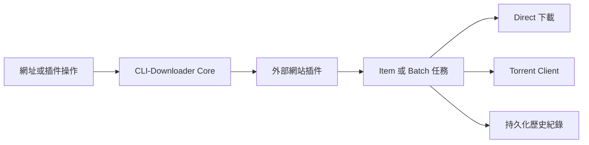

<p align="right">
  <a href="README.md">English</a> |
  <strong>繁體中文</strong> |
  <a href="README.zh-CN.md">简体中文</a>
</p>

<p align="center">
  
</p>

<h1 align="center">CLI-Downloader</h1>

<p align="center">
  具備持久化任務、Batch 控制、Torrent 整合<br>
  與互動式終端介面的插件驅動下載管理器。
</p>

<p align="center">
  <a href="https://github.com/RyuuMeow/CLI-Downloader/actions/workflows/verify.yml"></a>
  <a href="https://github.com/RyuuMeow/CLI-Downloader/releases"></a>
  
  
  
</p>

<p align="center">
  
</p>

CLI-Downloader 提供一致的任務、歷史紀錄、設定與使用者介面層，網站支援則由可獨立維護的外部插件提供。它適合互動式終端操作、可重複執行的 Batch 下載，以及透過機器可讀輸出進行自動化。

## 功能特色

- **一套程式支援多個網站。** 透過可安裝的插件加入需要的網站，不必在多套下載器之間切換。
- **關閉程式也能接著下載。** 任務與 Batch 進度會持久保存，重新開啟後不會遺失下載狀態。
- **大型下載仍然容易控制。** 隨時暫停、繼續、取消、重試，必要時也能完整重建 Item 或 Batch 任務。
- **自由選擇下載方式。** 使用 Direct 下載、設定好的 Torrent Client，或由插件自動選擇最適合的方法。
- **任務與歷史紀錄互不綁死。** 清除已完成任務時，可以保留獨立且持久的下載紀錄。
- **直接在程式內尋找插件。** 瀏覽 Official 與 Community 清單、查看詳細資訊及可用更新。
- **介面操作與自動化都支援。** 使用鍵盤操作的終端介面，也能透過 JSON 輸出接入腳本與其他工具。
- **適合不同使用方式。** 可選擇 Installer 或 Portable，介面支援英文、繁體中文與簡體中文。

## 快速開始

### Windows Installer

從 [GitHub Releases](https://github.com/RyuuMeow/CLI-Downloader/releases/latest) 下載最新的 `CLI-Downloader-<version>-windows-x64-setup.exe`。Installer 採個人使用者安裝，可將 CLI-Downloader 加入使用者 `PATH`，且不需要系統管理員權限。

### Windows Portable

下載並解壓縮最新的 `CLI-Downloader-<version>-windows-x64-portable.zip`。執行 `CLI-Downloader.exe` 可直接開啟互動式 Shell；使用 `clid.cmd` 則可轉發命令列參數，且不會修改 `PATH`。

### 從原始碼執行

需要 Python 3.11 或更新版本。

```powershell
git clone https://github.com/RyuuMeow/CLI-Downloader.git
cd CLI-Downloader
python -m pip install -e .
clid
```

## 基本用法

開啟互動式 Shell：

```powershell
clid
```

透過已安裝的插件處理網址、先查看下載計畫，以及查詢持久化狀態：

```powershell
clid download <url> --dry-run
clid download <url>
clid download <list-url>
clid download <list-url> --select <item-id>
clid tasks
clid history
clid plugins list
clid doctor
```

使用 `clid <command> --help` 查看各指令選項。支援 `--json` 的指令可供腳本及其他工具讀取。

命令列中的清單或 Batch 網址若未指定 `--select`，會下載該 operation 回傳的全部項目；可重複
使用 `--select <item-id>` 將 Batch 限制為指定子集。互動式 Shell 仍會顯示插件提供的勾選頁面。

若由 Agent 協助操作，請讓下載留在使用者看得到的 Shell owner 中：

```powershell
clid shell status --json
clid shell ensure --visible --wait-ready --json
clid download <url> --dry-run --json
clid download <url> --detach --json
clid tasks show <task-id>
clid tasks pause <task-id>
clid tasks resume <task-id>
```

`--detach` 只代表任務已持久化接受，並不代表下載最終成功。若 owner 中斷，請先查詢原有
Task 與 History，再決定是否用相同 request 重試，不要建立替代 Task。完整的授權與 owner
流程請參考 [Agent Skill 指南](skills/cli-downloader/README.md)。

如果可見的 Shell 在仍有未完成工作時關閉，會先顯示警告、停止接受新指令，並留下可由下次
Shell 啟動時恢復的檢查點。

## 介面導覽

### Tasks 與 Batches

查看 Item 與 Batch 階層、進度、排隊狀態及可用的生命週期操作；重新啟動程式後，持久化工作仍會保留。

<p align="center">
  
</p>

### 插件 Marketplace

瀏覽 Installed、Official 與 Community 插件，查看套件資訊，並在同一頁面辨識可用更新或需要重新啟動的狀態。

<p align="center">
  
</p>

### 插件 Operations

插件可以提供具備鍵盤選取及分頁功能的清單與搜尋操作；Core 則負責建立及控制實際下載任務。

<p align="center">
  
</p>

## 插件系統

CLI-Downloader Core 不內建任何網站專用下載器。已安裝的插件負責分類網址、解析網站資料並宣告支援的操作；Core 負責任務建立、排程、重試、儲存、下載及歷史紀錄。



遠端清單由 [CLI-Downloader Plugin Marketplace](https://github.com/RyuuMeow/CLI-Downloader-Plugin-Marketplace) 維護。啟用的插件屬於受信任的本機 Python 程式碼，並不在 Sandbox 中執行，因此請只安裝來自可信來源的插件。

套件結構、啟用行為與插件開發方式請參考 [Plugins/README.md](Plugins/README.md)。

想從現成結構開始開發插件，可以使用 [CLI-Downloader Plugin Template](https://github.com/RyuuMeow/CLI-Downloader-Plugin-Template)。完成後可依 [CLI-Downloader Plugin Marketplace](https://github.com/RyuuMeow/CLI-Downloader-Plugin-Marketplace) 的投稿方式提交，供清單收錄評估。

## Agent Skill

本專案提供可供相容 AI Agent 環境使用的 [CLI-Downloader Agent Skill](skills/cli-downloader/)，讓 Agent 能依照專案規範：

- 透過公開指令查看目前任務與持久化歷史，而不直接讀取資料庫；
- 在開始下載前使用 dry run 驗證網址路由；
- 取得使用者明確授權後建立並確認下載任務；
- 診斷不支援的網址與插件路由問題；以及
- 研究、建立、測試並撰寫外部網站插件文件；以及
- 將取得授權的工作送入可視化 Shell owner，並透過 JSON 指令控制結果 Task。

Agent Skill 不會取得額外權限、不會略過確認要求，也不代表第三方插件可信。Agent 仍須遵守使用者授權與其執行環境的安全邊界。

### 安裝 Skill

Clone 本專案後，請複製**完整的** `skills/cli-downloader` 目錄，才能一併保留參考文件與插件範本。

**Codex** — 安裝至目前使用者：

```powershell
New-Item -ItemType Directory -Force "$HOME\.agents\skills" | Out-Null
Copy-Item -Recurse -Force ".\skills\cli-downloader" "$HOME\.agents\skills\"
```

使用 `$cli-downloader` 可明確指定 Skill；請求內容符合時，Codex 也能自行選用。若只要在單一專案使用，請改為複製到 `<project>/.agents/skills/cli-downloader`。

**Claude Code** — 安裝至目前使用者：

```powershell
New-Item -ItemType Directory -Force "$HOME\.claude\skills" | Out-Null
Copy-Item -Recurse -Force ".\skills\cli-downloader" "$HOME\.claude\skills\"
```

使用 `/cli-downloader` 可明確指定 Skill；請求內容符合時，Claude 也能自行選用。若只要在單一專案使用，請改為複製到 `<project>/.claude/skills/cli-downloader`。

安裝範圍、驗證、更新及其他相容 Agent Skills 環境請參考 [Agent Skill 安裝指南](skills/cli-downloader/README.md)。

**也可以請 Agent 幫忙安裝** — 你可以對相容的 Agent 說：「請從這個專案安裝 CLI-Downloader Agent Skill，並確認安裝成功。」執行前請檢查 Agent 提出的檔案操作，並依你的環境權限規則核准。

## 下載策略

插件可以支援一種或多種策略：

- `auto` 由插件選擇最適合的可用方式。
- `direct` 由 Core 下載插件解析出的檔案。
- `torrent` 將 Torrent 提交至設定的 Torrent Client。

```powershell
clid download <url> --strategy auto
clid download <url> --strategy direct
clid download <url> --strategy torrent
```

實際可用策略取決於所選插件與網址。

## 任務、歷史紀錄與使用者資料

Tasks 代表目前可控制的工作；History 則是獨立的持久化紀錄。因此刪除 Task 不會刪除 History，除非使用者另外明確執行歷史紀錄操作。設定、插件、日誌、下載內容、任務與歷史紀錄都保存在個人使用者資料位置，升級或解除安裝時不會一併移除。

## 免責聲明

CLI-Downloader 是一個開源的**下載框架**。Core 本身不內建任何特定網站的支援或解析邏輯；與網站相關的行為由使用者自行安裝、獨立維護的插件提供。

### 本專案的性質

- Core 僅提供插件契約、任務排程、速率限制、持久化與下載管線等通用功能。
- CLI-Downloader 不對任何插件背書，亦不保證插件安全、合法、正確或符合目標網站的服務條款。
- 網路活動可能由已安裝插件發起，也可能由 Core 根據插件解析出的下載請求、插件清單存取或已設定的外部整合執行。

### 責任限制

- 本專案依 [MIT License](LICENSE) 授權，以**「現狀」（AS IS）**提供，不含任何明示或默示擔保。
- 使用本專案及任何插件之風險由使用者自行承擔，包括但不限於帳號限制、服務封禁、法律責任、資料遺失或非預期的網路及檔案系統活動；開發者與貢獻者概不負責。
- 使用者應自行遵守適用法律、著作權規範與目標網站服務條款，並取得所有必要授權或使用權利。
- 請勿將本專案用於未授權存取、侵害著作權、非法散布或具濫用性的大量請求。MIT License 允許本軟體用於商業用途，但不授予任何第三方網站或下載內容的權利。

### 插件

插件可能包含額外的網站存取行為與補充條款。安裝或使用前，請詳閱各插件的 README。Community 插件由第三方獨立維護，其行為與風險不代表 CLI-Downloader Core 專案立場。

安裝、編譯或使用 CLI-Downloader 或任何插件，即表示您已知悉本聲明及對應插件文件中的補充條款。

## 文件

- [專案範圍與行為](docs/CLI-Downloader.md)
- [文件索引](docs/Index.md)
- [系統架構](docs/structure/SystemDesign.md)
- [專案結構](docs/structure/SystemStructure.md)
- [變更紀錄](CHANGELOG.md)

## 開發

安裝開發及打包依賴後，執行完整驗證：

```powershell
python -m pip install -e ".[dev,package]"
.\Scripts\Verify.ps1
```

建立 Windows Portable 套件：

```powershell
.\Scripts\BuildPortable.ps1
```

歡迎透過 [GitHub Issues](https://github.com/RyuuMeow/CLI-Downloader/issues) 回報問題、提出功能建議、改善文件或討論插件契約。

## 授權

CLI-Downloader 採用 [MIT License](LICENSE) 發行。
