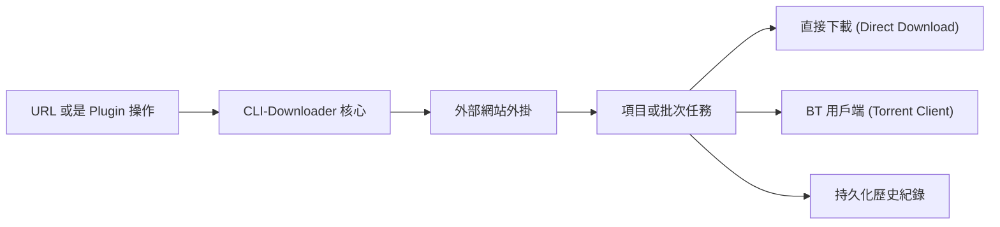

<p align="right">
  <a href="README.md">English</a> |
  <strong>繁體中文</strong> |
  <a href="README.zh-CN.md">简体中文</a>
</p>

<p align="center">
  
</p>

<h1 align="center">CLI-Downloader — 互動式擴充套件下載管理器</h1>

<p align="center">
  這是一個以擴充套件 (Plugin) 為核心驅動的互動式下載框架，專為瀏覽、收集以及整理來自需要登入認證網站的媒體資源而設計。<br>
  特別針對圖片收集和圖庫型工作流程進行了最佳化。
</p>

<p align="center">
  <a href="https://github.com/RyuuMeow/CLI-Downloader/actions/workflows/verify.yml"></a>
  <a href="https://github.com/RyuuMeow/CLI-Downloader/releases"></a>
  
  
  
</p>

<p align="center">
  
</p>

**狀態：** 早期預覽版。核心工作流程已可用，但外掛程式 (Plugin) API 在 v1.0 發布前仍可能發生變動。

## 為什麼選擇 CLI-Downloader？

你可以直接在終端機中瀏覽繪師的作品、選取多個圖庫、在需要時進行登入，並將下載結果自動整理得井然有序。

CLI-Downloader 提供了一個統一的介面，讓你不再需要到處尋找零碎的腳本，或為每個網站安裝獨立的下載工具。

### 完整操作流程

```text
安裝擴充套件 → 登入帳號 → 搜尋資源 → 選取目標 → 開始下載 → 隨時暫停與恢復
```

## 它有什麼不同？

雖然 **yt-dlp** 是影片提取領域的王者，而 **gallery-dl** 擅長無頭 (headless) 圖庫爬蟲，但 **CLI-Downloader** 更加專注於提供「持久化」和「互動式」的收集流程。我們將這個下載器視為一個互動中心，而所有的擴充套件都是在其內部運行的微型應用程式。

## 視覺導覽

### 任務與批次管理

在這裡你可以檢查單一項目與批次任務的層級、進度、佇列狀態以及生命週期操作。所有進度都會被持久化儲存，重新啟動應用程式也不會遺失下載紀錄。

<p align="center">
  
</p>

### 擴充套件市場 (Plugin Marketplace)

從這裡你可以瀏覽已安裝的、官方的以及社群提供的擴充套件；檢視套件資訊；並在同一個畫面中辨識更新或是否需要重新啟動。

<p align="center">
  
</p>

### 擴充套件操作 (Plugin Operations)

擴充套件可以提供包含鍵盤選取和分頁功能的列表與搜尋操作，而 CLI-Downloader 核心則持續負責建立與控制下載任務。

<p align="center">
  
</p>

## 核心與外掛架構

CLI-Downloader 核心 (Core) 不包含任何特定網站的下載邏輯。由使用者安裝的外掛 (Plugin) 負責對 URL 進行分類、解析網站資料，以及宣告支援的操作；核心則接管任務建立、排程、重試、儲存、下載和歷史紀錄管理。



## 核心功能

- **互動式擴充套件頁面：** 擴充套件可以直接在終端機介面中提供搜尋頁面、分頁列表、表單、操作行為以及多選工作流程。
- **瀏覽器登入工作階段：** 透過獨立的瀏覽器畫面完成登入，無需手動複製或提取 Cookies。
- **資料夾模板：** 自動將下載的檔案整理進客製化的資料夾結構中。例如：
  ```text
  {author_name}/{artwork_id}-{title}
  ```
  輸出：
  ```text
  繪師名稱/12345-插圖標題/
  ```
- **持久化任務：** 下載進度、佇列與任務狀態都會被儲存下來。隨時關閉程式，下次開啟時會從中斷的地方準確恢復。
- **多種下載策略：** 可以選擇直接下載檔案，或將任務移交給整合的 Torrent 客戶端處理。
- **自動化準備就緒：** 比較喜歡用腳本而非互動介面 (TUI)？每個命令都支援 `--json` 輸出格式，讓你輕鬆實現自動化。

## 支援的網站

CLI-Downloader 核心本身不包含網站爬蟲。**網站的支援功能需要透過擴充套件市場 (Plugin Marketplace) 額外安裝。**

目前庫內提供的官方擴充套件：
- **[Pixiv](https://github.com/RyuuMeow/Pixiv-Plugin.git)** (圖片、插圖)
- **[EHentai](https://github.com/RyuuMeow/EHentai-Plugin.git)** (圖庫、BT)
- **[X / Twitter](https://github.com/RyuuMeow/X-Plugin.git)** (圖片、影片)
- **[Douyin](https://github.com/RyuuMeow/Douyin-Plugin.git)** (圖片、影片)

你可以直接在應用程式的「Plugin Marketplace」分頁中瀏覽並安裝，或者使用指令：`clid plugins install pixiv`。

## 快速上手

### Windows 安裝檔

從 [GitHub Releases](https://github.com/RyuuMeow/CLI-Downloader/releases/latest) 下載最新的 `windows-x64-setup.exe`。它會將 CLI-Downloader 加進你的使用者 `PATH` 變數中，且不需要管理員權限。

### 可攜版 (Portable)

下載 `windows-x64-portable.zip`。解壓縮後執行 `CLI-Downloader.exe` 即可開啟互動式 Shell，或使用 `clid.cmd` 來傳遞命令列參數。

### 基本使用

開啟互動式 Shell：
```powershell
clid
```

或直接在命令列使用：
```powershell
clid plugins list
clid download <url> --dry-run
clid download <url>
```

命令列中的清單或 Batch 網址若未指定 `--select`，會下載該 operation 回傳的全部項目；可重複
使用 `--select <item-id>` 將 Batch 限制為指定子集。互動式 Shell 仍會顯示插件提供的勾選頁面。

若由 Agent 協助操作，請讓下載留在使用者看得到的 Shell owner 中：

```powershell
clid shell status --json
clid shell ensure --visible --wait-ready --json
clid download <url> --dry-run --json
clid download <url> --detach --json
clid tasks show <task-id>
clid tasks pause <task-id>
clid tasks resume <task-id>
```

`--detach` 只代表任務已持久化接受，並不代表下載最終成功。若 owner 中斷，請先查詢原有
Task 與 History，再決定是否用相同 request 重試，不要建立替代 Task。完整的授權與 owner
流程請參考 [Agent Skill 指南](skills/cli-downloader/README.md)。

如果可見的 Shell 在仍有未完成工作時關閉，會先顯示警告、停止接受新指令，並留下可由下次
Shell 啟動時恢復的檢查點。

## AI 代理技能 (Agent Skill)

此專案包含一個開箱即用的 Agent Skill（位於 `skills/cli-downloader`）。用它來強化你的 AI 助手（例如 Claude Code 或 Codex）。

**你可以要求 Agent 幫你：** 研究目標網站、搭建 Plugin 骨架、實作路由、新增測試，以及產生說明文件。

請參閱 [Agent Skill 說明文件](skills/cli-downloader/README.md) 了解安裝方式。

## 常見問題 (FAQ)

**這可以取代 yt-dlp 嗎？**
不行。如果你主要目的是從 YouTube 或是各大影音平台下載影片，yt-dlp 是更好的選擇。CLI-Downloader 的設計初衷是為了圖庫聚合、圖片收藏以及需要登入認證的瀏覽工作流程。

**擴充套件有沙盒 (Sandbox) 保護嗎？**
沒有。已啟用的擴充套件會作為受信任的本機 Python 程式碼執行。請務必只從你信任的來源安裝擴充套件。

**它可以支援需要瀏覽器登入的網站嗎？**
可以。你可以呼叫基於瀏覽器的登入流程，它會安全地持久化儲存你的工作階段狀態，免去了複製貼上 Cookies 的麻煩。

## 免責聲明與安全性

CLI-Downloader 是一個開源的下載框架，以「現狀 (AS IS)」提供。我們不背書也不保證任何第三方擴充套件的合法性。

- 有關安全實務與漏洞回報，請參閱 [SECURITY.md](SECURITY.md)。
- 有關完整的條款、責任限制以及擴充套件警告，請閱讀 [DISCLAIMER.md](DISCLAIMER.md)。

## 說明文件

- [CLI 指令手冊 (CLI Command Reference)](docs/CLI-Commands.md)
- [專案範圍與行為](docs/CLI-Downloader.md)
- [系統架構](docs/structure/SystemDesign.md)
- [儲存庫結構](docs/structure/SystemStructure.md)
- [更新日誌](CHANGELOG.md)


## 授權條款
採用 [MIT License](LICENSE) 釋出。
