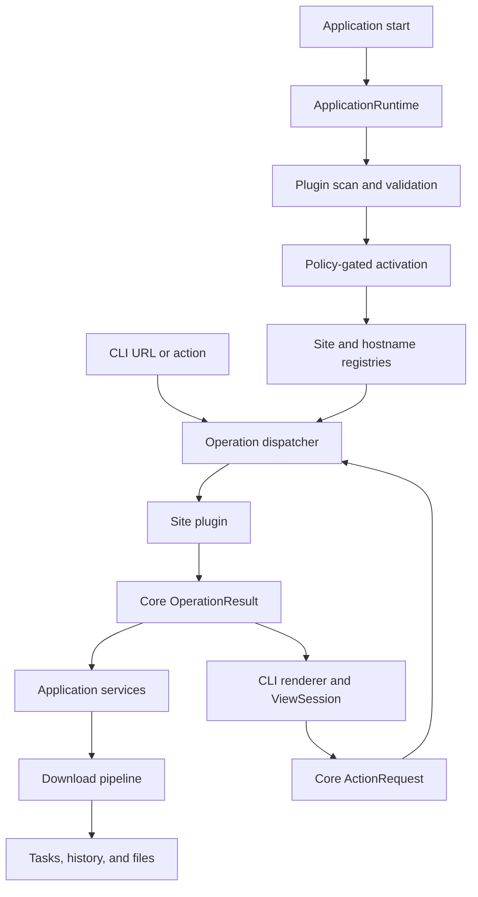

# System Design

Updated: 2026-07-06

## Design Principles

- Core contracts are site independent.
- Site-specific parsing and network behavior stay behind plugin boundaries.
- Plugins may define operation identifiers but not public data shapes.
- Interactive and non-interactive frontends consume the same core results.
- Download actions authorize expected network and file-writing behavior;
  inspection, dry-run, destructive actions, and external code retain explicit
  safety boundaries.
- Task and history state are persisted; temporary view state is not.

## Layers

| Layer | Responsibility |
| --- | --- |
| CLI and renderer | Parse commands, render core view objects, capture terminal input |
| Application runtime | Bootstrap plugin discovery, activation, registries, and shared services once per process |
| Operation dispatcher | Route requests, validate parameters and confirmations, invoke plugins, validate results |
| Application services | Orchestrate downloads, task lifecycle, history, and persistence |
| Core | Define requests, results, models, events, actions, widgets, and errors |
| Plugin system | Discover, validate, activate, and verify local plugin packages |
| Site plugins | Classify URLs and perform site-specific operations |
| Storage and integrations | Persist state and perform platform or filesystem actions |

## Runtime Flow



## Plugin Boundary

Plugin metadata and static schemas come from `plugin.json` and the declared site
manifest. External Python code is activated only after static validation and an
explicit policy gate.

The runtime maintains:

- plugin-id lookup;
- site-id lookup;
- normalized-hostname lookup;
- normalized manifest lookup.

The runtime scans once per process. Placement in the fixed project or
LocalAppData roots is the durable activation policy; arbitrary `--plugin-root`
locations still require `--enable-external-code`. Plugin-id, site-id, and
normalized-hostname conflicts are rejected before an external entrypoint is
imported. Interactive shell commands receive the same runtime instance.

New site integrations are external Plugins. The target runtime scans fixed
application-root `Plugins/` packages before active versioned LocalAppData
installs; it never treats an arbitrary current working directory as a Plugin
root. Project Plugins may override installed Plugins with an explicit source
diagnostic, while duplicate ids within one root are rejected. Existing built-in
sites remain only until separately migrated.
[ADR-0009](ADR/0009-versioned-external-plugin-sources.md) defines distribution
and precedence.

Each runtime entry also owns an `AssetFetcher`. Normal HTTP assets use the
system fetcher; a Plugin may implement async `fetch(asset)` for authenticated or
site-specific requests. Direct, Batch, and retry downloads consume this same
runtime registration.

Plugins may also implement synchronous `configure(settings, secrets)`. The
runtime supplies only that Plugin's namespaced values before operations begin;
secret values remain outside core requests, results, task metadata, and logs.

Plugins accept core `OperationRequest` objects and return core
`OperationResult` objects. Public arbitrary dictionaries, callbacks, custom
widgets, and renderer-native objects are not allowed.

## Routing

The router parses and normalizes the URL hostname before registry lookup.
Manifest rules provide inexpensive first-pass matching. The selected plugin may
perform final classification and returns a core `RouteMatch`.

The Shell may normalize a submitted input containing only one absolute HTTP(S)
URL into the existing `download <url>` command. Drag-and-drop is terminal text
input, not a separate execution channel: pressing Enter remains the explicit
download action, and every confirmation, duplicate check, queue, and Plugin
routing rule remains unchanged.

Operation identifiers may be plugin-defined and are validated against manifest
schemas.

## Scheduler Owner And Agent IPC

One `OwnerScope` (product namespace, current-user identity, canonical data root,
and protocol generation) has exactly one live Scheduler owner. The interactive
Shell is the preferred owner. A foreground CLI may own the scope only when no
Shell is ready; an external CLI otherwise submits a validated `OwnerRequest`
through the local owner transport.

Windows uses a scope-derived Named Pipe with an authenticated handshake;
POSIX development uses a private Unix socket. Restricted Windows runners may
use an ephemeral loopback endpoint only as an authenticated fallback. Endpoint
metadata contains the complete scope fingerprint and is treated as discovery,
not proof of liveness. The OS lease remains authoritative.

Requests carry a stable request ID and response mode (`wait` or `detach`). The
owner persists response events before sending them, so a retry can replay the
same acceptance and terminal result instead of creating duplicate Tasks. Connect,
handshake, acceptance, and response-idle waits are independently bounded;
heartbeat and `owner_disconnected` events make a dead owner observable without
inventing completion. Accepted work is reconciled from persisted Task, Batch,
and torrent checkpoints by the next owner.

Shell shutdown sets a stopping boundary before releasing the `OwnerScope` lease:
new owner requests are rejected, active cancellation signals are propagated to
download workers, active run checkpoints are normalized to recoverable planned
state, and the Shell waits briefly for safe worker boundaries. The wait is bounded
so a stuck integration cannot orphan the CLI indefinitely; the next owner performs
the remaining checkpoint reconciliation.

## View And Interaction

Plugins compose dynamic pages from core widget classes and enum-controlled
events, actions, properties, and selection modes.

The first renderer is terminal based and must support keyboard focus movement,
selection, input, pagination, confirmation, cancellation, and back navigation.
The chosen terminal library is an adapter detail and must not leak into plugin
contracts.

Interactive state is stored in an in-memory `ViewSession`. Non-interactive and
`--json` modes never prompt and return structured `InteractionRequired` results
when more input is necessary.

Selections spanning list pages retain core candidate data in an in-memory
basket. Confirmation passes those candidates directly to the batch application
service rather than reconstructing prior pages through CLI arguments.
[ADR-0007](ADR/0007-cross-page-selection-handoff.md) defines this boundary.

The persistent Shell follows the interaction and visual rules in
[Shell Experience Design](../dev/shell_experience_design.md).

## Configuration

The core owns shared download, network, retry, and policy schemas. Enabled
Plugins register site-specific fields only under `plugins.<plugin_id>` and may
read only explicitly exposed global values. Secrets remain references to the
secrets service. [ADR-0006](ADR/0006-global-and-plugin-settings.md) defines
schema ownership and registration.

`ApplicationRuntime` builds one `SettingsRegistry` from active manifests.
`ConfigLoader` validates the resulting combined schema, and the operation
dispatcher projects only the target Plugin's local values, approved globals,
and canonical secret references into each `OperationRequest`.

A Manifest may register one core-owned `browser_auth` profile. The profile
declares an HTTPS login URL, allowed first-party Cookie domains, optional Cookie
names that prove login completion, and explicit local-storage capture opt-in.
The Shell renders the generated `plugins.<plugin_id>.auth.session` secret as a
Login or Disconnect action. Core starts an installed Edge or Chrome normally
with a temporary isolated profile and a generated Manifest V3 bridge extension.
The extension can read only Manifest-declared Cookie domains and can return data
only to a random one-use localhost callback. Existing browser profiles and
third-party Cookies are never read. Core helpers validate the stored session and apply URL,
domain, path, Secure, and expiry matching before a Plugin sends a request. A
Plugin may implement `validate_auth_session()` for site-specific proof of login;
the managed browser remains open until both common and Plugin validation pass.

Network pacing is a system policy shared by every active Task for the same
Plugin/site identity. Manifest `network` declares request concurrency, minimum
interval, retryable HTTP statuses, total attempts, and fallback backoff ceiling;
the settings registry exposes scalar overrides under
`plugins.<plugin_id>.network`. Plugin resolution and Asset fetch boundaries use
the same core request gate. `Retry-After` takes precedence over exponential
backoff with jitter, and exhausted failures persist their attempt count and
`next_retry_at` so manual Batch retry cannot bypass an active cooldown.

The global `download.folder_template` remains the fallback relative Gallery
folder policy. A Plugin may register additional scalar output fields and a
default template in its Manifest; the settings registry then exposes an
optional `plugins.<plugin_id>.download.folder_template` override. Effective
precedence is Plugin user override, Plugin default, then global default.

Plugins provide common field values but never construct filesystem paths or
execute formatting code. The core accepts only registered labels, snapshots the
effective template and values with the task, sanitizes every component, and
rejects absolute or escaping templates. Template folders may be intentionally
shared; only duplicate filenames receive a stable Asset-owned suffix, so retries
reuse their path without overwriting another file.

## Task Hierarchy

The public task model is one tree. An Item task represents one downloadable
Gallery or equivalent item. A Batch task contains Item tasks and aggregates
their status and file progress. Standalone Items and Batches are top-level;
Batch children are revealed by entering the container.

A Batch stores an immutable user-facing title snapshot supplied through common
Plugin list data. If no title is provided, the system uses a short parent id.
The type icon communicates that the record is a Batch; the title is not forced
to contain `Batch` and is not user-editable.

Task list projections include their first persisted history timestamp as
creation metadata. This keeps display concerns outside standalone and Batch
execution records while allowing both kinds to share one chronological table.

Preparation may fail before a complete package exists, so Item tasks can retain
Plugin-owned failures without executable assets. Validated packages, scheduler
children, files, attempts, and checkpoints remain normalized internal records
behind the common task application API.

Item and Batch actions use one lifecycle contract. Batch actions cascade,
cooperative pause stops at request or file boundaries, cancellation preserves
completed files, retry resumes from the last valid checkpoint, and record
deletion never removes output files. [ADR-0008](ADR/0008-unified-task-hierarchy.md)
defines this public topology.

`TaskHierarchyService` is the common application boundary. It projects legacy
standalone task records and normalized Batch pipeline records into core
`TaskNode` values. Batch entries are public Items before package creation;
`DownloadChild` remains an internal executable record. Standalone downloads
persist completed count, total count, and output paths after each file.

## Download Pipeline

Single and batch downloads use the same plugin-to-system ownership boundary:

```text
plugin resolve and enumerate
-> core package validation
-> persist package and create executable child
-> system schedule, fetch, verify, and write
```

Site plugins produce complete core download packages. Application services own
validation, task creation, queues, task events, output writing, and history.
Standalone Items and Batch children acquire the same process-wide Gallery
download limiter before entering the system fetch/write stage. The default
limit is two and is controlled by `download.max_concurrent_galleries`.

## Pipelined Scheduling

A confirmed list selection creates one persisted parent and one entry per
selected gallery. Browsing and selection alone create no download work. Entries
resolve independently through a bounded plugin queue. A complete package is
persisted and its executable child is created transactionally, then placed on a
separate bounded system download queue without waiting for the rest of the
batch.

Entries remain attached to the parent when plugin resolution fails or the
system rejects a package, so every selected gallery stays visible and retryable.
Children exist only after complete package validation.

The interactive Shell persists standalone plans before downloading. On a new
Shell session, interrupted planned or running Items are requeued with their
existing task ids so history, progress, and folder ownership remain connected.

Plugin and system failures use a core origin and stage. Retry plans begin from
the last valid checkpoint: failed entries return to plugin resolution, while
partial children normally retry only unsuccessful assets. Expired packages are
refreshed through the plugin and reconciled by logical asset id rather than URL.

Parent state is derived from all entry and child outcomes. Cancellation keeps
completed files, and duplicate downloads default to skip unless explicitly
forced. [ADR-0005](ADR/0005-pipelined-batch-parent-child-tasks.md) defines the
models, states, aggregation, retry, refresh, cancellation, duplicate, and queue
rules. Parent, entry, and child remain pipeline terms; the user-facing model is
the Item and Batch hierarchy in ADR-0008.

## Dependency Rules

- `core` does not depend on CLI, storage implementations, or site packages.
- `application` depends on core contracts and abstract service boundaries.
- `cli` may depend on application services and renderer adapters.
- `sites` may depend on core contracts but not CLI renderer implementations.
- `plugins` may validate site contracts but must not own application workflows.
- storage and platform integrations do not define domain behavior.

## Security Boundaries

- External plugins are trusted local code, not sandboxed code.
- Static plugin files are validated before Python import.
- Sensitive values remain behind config and secrets services.
- URL-opening actions validate allowed schemes.
- Explicit `download` actions authorize expected network and file writes;
  inspection and dry-run operations remain side-effect free.
- Widget bindings can only perform core-enumerated actions on whitelisted
  properties.

## Architecture Change Policy

This document establishes the architecture baseline. Changes to layer
responsibilities, plugin boundaries, persistence, communication patterns,
external dependency strategy, or security behavior require an RFC and ADR
update before implementation.
